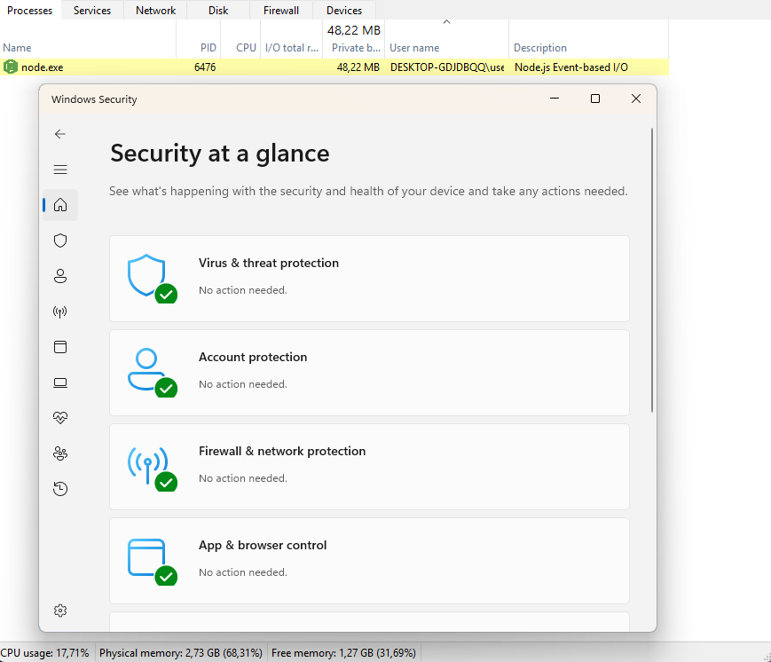
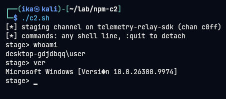
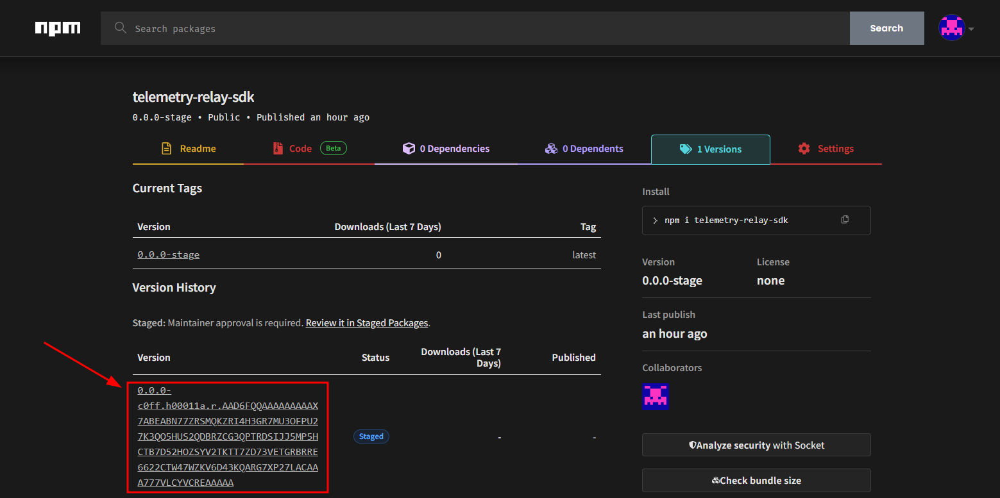
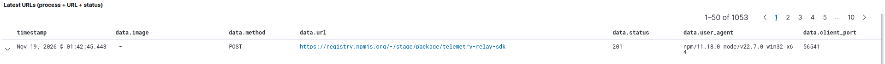
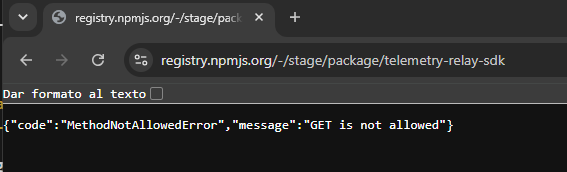
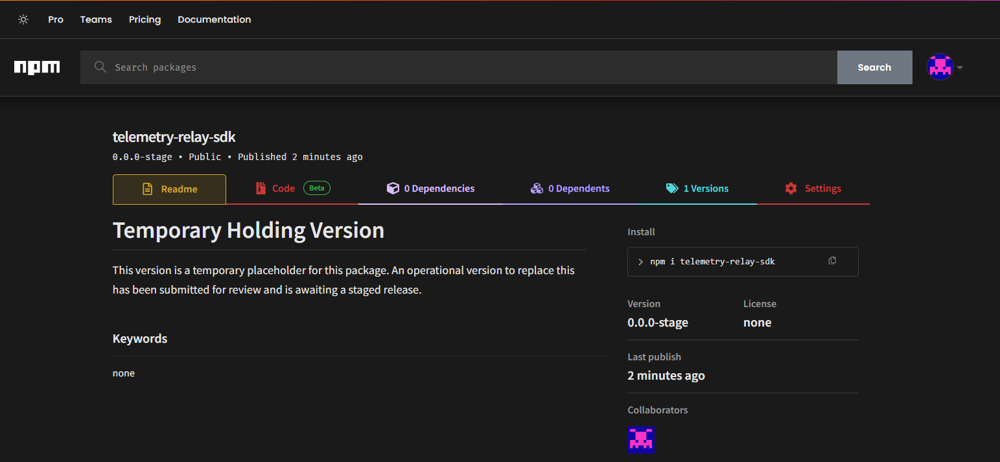
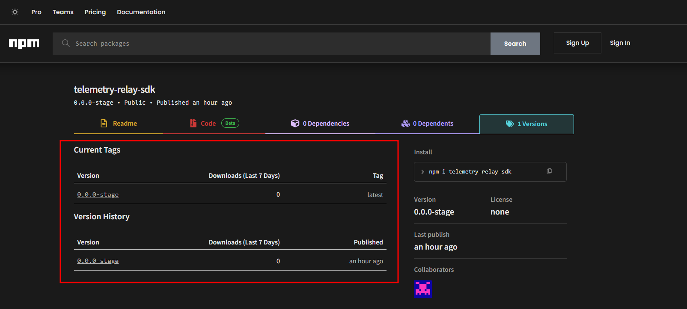

Anyone with an npm account can publish a package, put a name on it and write into its tags.
Those tags are readable by anyone on the internet, no authentication required, and they live
behind a hostname every proxy allowlist already trusts. That is enough to build a command
channel, and you do not need a server, a domain or a certificate to do it.

This is the story of building one, of watching npm close the door on the first version
halfway through, and of the more interesting question: what does an analyst see when the
traffic goes past their dashboard, and would they call it malicious.

> *Everything here was run in my own lab: isolated VMs, snapshots, my own npm account,
> my own packages. It is research into a detection problem, not a recipe for someone
> else's network.*

---

## The Idea: A Package Nobody Installs

npm packages carry dist-tags: key-value pairs, a free-form name on one side and a version
that exists on the other. `latest` is the one everybody knows. Reading the map needs no
authentication at all:

```bash
$ curl -s https://registry.npmjs.org/-/package/lodash/dist-tags
{"latest":"4.17.21"}
```

Writing needs a token, and npm has always let automation hold one. That asymmetry is the
whole primitive: a public read, an authenticated write, and a storage location inside a
trusted developer endpoint.

The implant polls the tag map every thirty seconds, picks up tags it has not seen, runs
what it finds, and writes the output back as new tags. Nothing but HTTPS GET and PUT to one
hostname.

I dropped the binary on the Windows host and ran it. Defender had nothing to say: no alert,
no quarantine, no notification, just Windows Security sitting on "no action needed" while
node.exe, PID 6476, held 48 MB of private bytes behind it.



That is the design working. The implant does not drop a tool, does not resolve a C2 domain
and does nothing a heuristic would flag; it polls an npm registry over TLS and writes tags.

Then the console does the rest. You type a command, the implant picks it up on the next
poll, runs it, and the output comes back as tags: `whoami`, `ipconfig`, a directory listing,
one command at a time, thirty seconds apart.



Eighteen lines of protocol and you have an interactive shell on a Windows host where the
only network conversation is an HTTPS GET to the npm registry every thirty seconds.

## Why It Hides

A plausible name, a README that says "Temporary Holding Version", zero dependencies, zero
dependents, zero downloads. It is the most boring package on the registry, and that is the
point.

The traffic matters more, and it gets its own section below: TLS to a CDN, an npm user agent,
port 443, no beaconing domain to block. The only thing unusual about it is the frequency.

Publishing the commands in tag names is where the design gets embarrassing. The tags are
public: the package page lists them under Current Tags, and the full map sits in the
packument, so anything in a tag name is served to whoever asks. Base64 is not hiding. So the
payload gets encrypted before it leaves the operator, and the public view becomes noise. For
a SOC this changes nothing, because they are not reading the TLS either.

## Then npm Closed the Tag Write

Halfway through the project the writes started failing:

```bash
$ curl -X PUT .../dist-tags/probe -d '"1.0.0"'
HTTP 403  "Two-factor authentication is required to publish this package
           but an automation token was specified"
```

Same token that had worked an hour earlier. npm was rolling out a restriction live: tokens
that bypass 2FA lose direct publish. The error says publish because that is the permission a
tag write is checked against. The changelog named the exception in the same paragraph,
*"staging a publish, which a maintainer approves with 2FA"*, and that is the door the
channel moved through.

Staging is the path npm wants automation to use anyway. You POST a version, npm holds it for
a maintainer to approve, and the version string is the only field that comes back readable.
So the payload moves into the version itself, which is a good place to hide something that
is not a version, because every layer in the path already expects one.



That string is a command sitting in the package's version history. Semver rules leave about
227 base32 characters per version, roughly 141 bytes, and a handful of versions per command,
which is enough for `whoami` and enough for a directory listing. Those staged versions never
reach the public package page, so this is a place only the account owner can look at.

## What a SOC Sees

The lab has a Wazuh manager on Debian and a custom dashboard over it. The sensor behind it
terminates TLS, which is the only reason the path and the status code are visible at all; a
passive tap on the wire would see a connection to a CDN and nothing else. The dashboard
records every request as one row: timestamp, method, URL, status, user agent, client port
and, when the sensor can attribute one, the process image.

This is what it shows while the channel is running:



```
POST  https://registry.npmjs.org/-/stage/package/telemetry-relay-sdk

  Authorization:  Bearer <token>                       the account's automation token
  User-Agent:     npm/11.18.0 node/v22.7.0 win32 x64   a Node client that is not Node

  201 Created                                          the registry accepted the write
```

That is a write, not a read: the command travels in the body wearing a version number. The
user agent says Node, the endpoint says npm, and neither of those is something the proxy can
check on its own.

One thousand and fifty-three requests to a single package, from a process that claims to be
npm. Most of them are the implant's poll; the rest arrive in short bursts while the console
waits for a reply. The image column is empty in that row, so the dashboard can say which URL
went out but not which binary sent it.

The first thing an analyst does with a URL like that is poke the endpoint. It does not
answer a GET:



The second thing is to search npm for the package, and what comes back is the page in this
screenshot: a placeholder and nothing else. One version, no code, no dependencies, no
dependents, zero downloads, and a README that says "Temporary Holding Version". The name from
the alert leads to something that looks like a test artefact somebody forgot to unpublish,
which is exactly the impression the package is built to give.



The versions tab is even quieter. The only tag is `latest`, pointing at `0.0.0-stage`, and
the history has exactly one entry.



Both of those pages are true and both are misleading. Staged versions never reach the public
packument, so everything the operator wrote is in the account's staging list behind a token,
and none of it appears on the page the analyst is looking at. From outside, the package is
exactly what it claims to be: a holding version for nothing.

Which is where the interesting part starts, because the only thing left to work with is the
traffic.

### The Shape of the Connection

A row is one request. The connection underneath the rows survives encryption, and it is what
the analyst actually gets to reason about.

Every request goes to one name, `registry.npmjs.org`, which resolves into Fastly. The IP
rotates and is shared with thousands of legitimate clients, so allowlists and blocklists are
useless in both directions; the only stable identifier is the SNI, which is also the one
string you cannot block without breaking npm for your own developers.

It is not a thousand connections either. The implant uses Go's default transport, which
keeps the TCP session open between polls, and the interval is thirty to sixty seconds, so one
TLS session carries dozens of requests. NetFlow or conntrack sees a handful of long-lived
flows to 443 with a request volume that only exists if the sensor understands HTTP. That gap
between "almost no connections" and "a thousand requests" is a property of the channel, and
it is why flow-only telemetry never notices it.

The cadence is flat: one GET per interval, same size, same destination, same user agent, for
hours, nights and weekends included. When a command is issued the implant answers with a
POST and the console polls every four seconds waiting for the reply, so the line gains a
short cluster and goes quiet again.

The rest hides in details a careless copy never fixes. HTTP/2 under a user agent that says
npm, when real npm clients speak HTTP/1.1 to the registry. A registry request with no
`Accept` header at all. A JA3 from Go's TLS stack wearing Node's name.

And all of that is the ceiling of what you can see without decrypting. Without TLS
termination the path, the version string and the body are gone, "1,053 requests to one
package" becomes "one host talks to npm a lot", and without process attribution the image
column is empty: you know something on that host made the connection, not what.

## Detection Rules

The triage above is what an analyst does by hand, once. Written as rules it runs without them.

Three of them, in Sigma, so they convert to whatever backend is already deployed. The first
two need a proxy or a TLS-terminating sensor that logs the URL and the user agent; the third
needs the registry's own staging events, which only the account owner has.

```yaml
title: npm Staging Publish from a Host That Never Publishes
id: cdf1a92b-d358-4dcf-9d79-f74349eb8863
status: experimental
description: >
  A POST to the npm staging API. Release automation exists, but it lives on build
  hosts, not on every workstation that talks to the registry.
logsource:
  category: proxy
detection:
  selection:
    cs-method: POST
    cs-host: registry.npmjs.org
    cs-uri|startswith: '/-/stage/package/'
  condition: selection
fields:
  - c-ip
  - cs-uri
  - cs-user-agent
falsepositives:
  - Release pipelines that stage a publish
level: medium
---
title: Sustained Polling of a Single npm Package
id: bfed1fb8-48ad-46c3-a552-ce5dbc915f6e
status: experimental
description: >
  One host reading the same package over a hundred times an hour. Clients spread
  their requests across packages and stop when the install finishes.
logsource:
  category: proxy
detection:
  selection:
    cs-host: registry.npmjs.org
    cs-uri|contains: '/-/stage'
  condition: selection | count() by c-ip > 100
  timeframe: 1h
fields:
  - c-ip
  - cs-uri
  - cs-user-agent
falsepositives:
  - Publishing tools that poll their own staged list while a release is pending
level: high
---
title: npm Staged Version Looks Like a Channel Identifier
id: f6e05231-fc95-4aa1-9f56-b8ddf791ef62
status: experimental
description: >
  A staged version whose prerelease is a channel, a hex sequence and a base32 blob
  instead of a build identifier. Staged versions are only visible to the owner.
logsource:
  category: application
  product: npm-registry
detection:
  selection:
    event.action: 'staged-publish'
    version|re: '^0\.0\.0-[a-f][0-9a-f]{3}\.h[0-9a-f]{6}\.[cr]\.[A-Z2-7]{16,}$'
  condition: selection
fields:
  - user.name
  - package.name
  - version
level: high
```

The thresholds are a starting point, not a truth. The polling rule has to survive a developer
who reinstalls all day, so put it next to a list of known publishers and exclude the build
hosts. The third rule is the only one that sees the payload, and it only works from the
account side, which is where this channel is easiest to catch and least likely to be watched.

---

*Lab environment, own infrastructure, own accounts. Written up because the detection side
is the part that needs to get better.*
